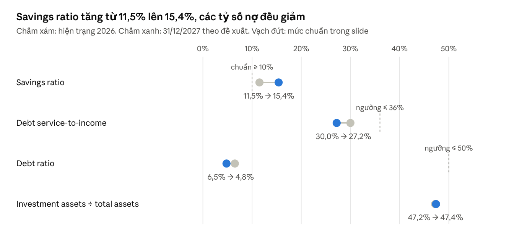

# BAF706 Family A: Dàn ý báo cáo nhóm (v4)

Oct 19, 2026 · @thomas

Ở hiện trạng (10/2026), Family A chỉ có một sổ tiết kiệm 5 tỷ ở Vietcombank, chưa tách quỹ nào; hai vợ chồng đã có bảo hiểm nhân thọ trọn đời từ 1/2022 nhưng mức bảo vệ chưa đủ; các quỹ, bảo hiểm bổ sung (có kỳ hạn, sức khỏe) và kế hoạch đầu tư chỉ xuất hiện ở Part 4. Giải pháp áp dụng từ 1/1/2027 (quỹ học tập, bảo vệ rủi ro, quỹ hưu trí ETF); dàn ý theo cấu trúc Part 1–5 của brief. Đơn vị: triệu VND.

## 0. Hiện trạng và giả định chính

| Thành viên | Thông tin |
| --- | --- |
| Ông A, 47 tuổi | Lao động chuyên môn; gross 63,1, thực nhận 54/tháng |
| Bà B, 45 tuổi | Lao động chuyên môn; gross 50,1, thực nhận 43/tháng |
| Con gái, 20 tuổi | Sinh viên năm hai, học phí 70/năm; du học thạc sĩ 2 năm từ 9/2028 (800/năm) |
| Con trai, 16–17 tuổi | THPT, học phí và học thêm 45/năm; đại học trong nước 4 năm từ 9/2028 (100/năm), du học thạc sĩ 2 năm từ 9/2032 (800/năm) |

| Tài sản, nợ hiện tại | Giá trị | Ghi chú |
| --- | --- | --- |
| Tài khoản thanh toán nhận lương | 100 |  |
| Sổ tiết kiệm 12 tháng tại Vietcombank, lãi 5,9% | 5.000 | Một sổ duy nhất, tái tục hằng năm |
| Nhà ở Quận 4 (giá mua 7/2023) | 11.000 |  |
| Hai xe máy, nội thất, đồ điện tử | 400 | Ước tính |
| Giá trị hoàn lại bảo hiểm nhân thọ trọn đời | 250 | Giả định, khoảng một nửa số phí 500 đã đóng |
| Căn hộ 3PN Saigon Pearl, cho thuê 30/tháng | 15.000 |  |
| Vay mua nhà Vietcombank (dư nợ) | 2.050 | Gốc 3.000 từ 7/2023, gốc đều, 8% hai năm đầu, nay thả nổi 10,5% |

- **Nguồn tiền:** nhà mua 7/2023 bằng tích lũy khoảng 4.500, ông bà hỗ trợ khoảng 3.500, vay 3.000. Căn hộ Saigon Pearl do bố mẹ tự mua từ trước bằng tiền tích lũy. Năm 2025 ông bà mất, để lại khoảng 4.000 tiền mặt; cộng khoảng 1.000 gia đình tự tích lũy thành sổ 5.000.
- **Bảo hiểm:** nhân thọ trọn đời (whole life) mua 1/2022, đóng phí 15 năm (1/2022 đến 1/2036). Ông A số tiền bảo hiểm 2.000, phí 60/năm; Bà B 1.500, phí 40/năm (giả định theo biểu An Phát Trọn Đời). Tổng phí 100/năm (8,3/tháng), đã đóng 5 kỳ (500). Chưa có bảo hiểm sức khỏe tự nguyện; bảo hiểm bắt buộc ở bảng dưới.
- Không có thẻ tín dụng, vay tiêu dùng. Lãi tiết kiệm không tính vào thu nhập (nhập gốc).
- **Giả định kinh tế:** lạm phát 4%/năm; lợi suất quỹ học tập 6,5%/năm (giữa sổ 12 tháng 5,9% và chứng chỉ tiền gửi 7,4%); lợi suất dài hạn 8%, sau nghỉ hưu 7%, lãi suất thực 3% (theo template).

Bảo hiểm bắt buộc theo lương (triệu/tháng). Từ 1/7/2026 lương làm căn cứ đóng BHXH, BHYT tối đa 50,6 (20 lần lương cơ sở 2,53), nên Ông A (gross 63,1) đóng trên 50,6, còn Bà B (50,1) đóng trên lương thật; BHTN có trần riêng cao hơn nên cả hai đóng trên lương thật. Tỷ lệ người lao động đóng: BHXH 8%, BHYT 1,5%, BHTN 1%; công ty đóng 17%, 3%, 1% và tai nạn lao động 0,5%.

| Loại bảo hiểm | Ông A tự đóng | Công ty đóng cho Ông A | Bà B tự đóng | Công ty đóng cho Bà B |
| --- | --- | --- | --- | --- |
| BHXH | 4,048 | 8,602 | 4,008 | 8,517 |
| BHYT | 0,759 | 1,518 | 0,752 | 1,503 |
| BHTN | 0,631 | 0,631 | 0,501 | 0,501 |
| BHTNLĐ-BNN | 0 | 0,253 | 0 | 0,251 |
| Tổng | 5,438 | 11,004 | 5,261 | 10,772 |

Hai vợ chồng tự đóng 10,7/tháng (128,4/năm), đã trừ vào lương trước khi ra thực nhận 54 và 43. Phần công ty đóng (21,8/tháng) không phải chi tiêu của gia đình nên không đưa vào cash flow.

## Part 1 – Introduction (1,5–2 trang, sheet 1\_Profile)

1. **Research approach:** gia đình giả định theo bối cảnh TP.HCM 2026 (brief mục II cho phép); ẩn danh Ông A, Bà B, con gái, con trai. Mọi giả định gom vào một bảng riêng, các phần sau không nhắc lại.
2. **Household profile:** bảng thành viên ở mục 0; sống tại nhà riêng Quận 4; thu nhập từ lương hai vợ chồng và tiền thuê căn hộ.
3. **Dòng thời gian:** 1/2022 mua bảo hiểm nhân thọ trọn đời cho hai vợ chồng; 7/2023 mua nhà, vay 3.000; 8/2025 hết lãi cố định; 2025 nhận thừa kế, gửi toàn bộ 5.000 vào một sổ 12 tháng.
4. **Current financial goals** (gia đình nêu, chưa lượng hóa): cho hai con du học thạc sĩ (ưu tiên hàng đầu), trả hết nợ nhà, nghỉ hưu theo tuổi luật định (Ông A 62 tuổi, sau 15 năm). Part 4 sẽ viết lại các mục tiêu này theo dạng SMART.
5. **Giả định kinh tế** (sheet 1\_Profile mục C): lạm phát 4%, lãi tiền gửi 5,9%, lợi suất dài hạn 8%, sau nghỉ hưu 7%, lãi suất thực 3%; mỗi giả định kèm nguồn.

## Part 2 – Analysis of the current financial situation (5–6 trang, sheet 2, 3, 4)

Gia đình giàu tài sản, nợ thấp và tiết kiệm khá (11,5% thu nhập), nhưng 5 tỷ tiền gửi nằm chung một sổ, chưa gắn với mục tiêu nào. Tất cả số liệu ở Part 2 là hiện trạng, chưa áp dụng giải pháp.

### 2.1 Balance Sheet

| Nhóm | Khoản | Giá trị |
| --- | --- | --- |
| Liquid | Tài khoản thanh toán 100 + sổ tiết kiệm 5.000 + giá trị hoàn lại bảo hiểm nhân thọ 250 | 5.350 |
| Use | Nhà 11.000 + xe máy, nội thất 400 | 11.400 |
| Investment | Căn hộ Saigon Pearl | 15.000 |
| Total assets |  | 31.750 |
| Long-term liabilities | Vay nhà Vietcombank | 2.050 |
| Net worth | 31.750 − 2.050 | 29.700 |

Trình bày theo mẫu Hernandez family; biểu đồ cơ cấu tài sản (căn hộ 47,2%, nhà 34,6%, tiền gửi 16,1%, xe và nội thất 1,3%, giá trị hoàn lại bảo hiểm 0,8%). Giá trị hoàn lại xếp vào Liquid theo bảng phân loại tài sản ở slide Chương 2 (cash value of life insurance là monetary/liquid asset). Khi tính needs approach ở Part 3 không cộng khoản này vào nguồn sẵn có, vì nếu người được bảo hiểm mất thì hợp đồng trả số tiền bảo hiểm chứ không trả thêm giá trị hoàn lại.

### 2.2 Cash-Flow Statement (theo tháng, thu nhập gross theo template)

| Khoản | Số tiền | % thu nhập |
| --- | --- | --- |
| Thu nhập: lương Ông A 63,1 + Bà B 50,1 + tiền thuê 30 | 143,2 | 100% |
| Bảo hiểm bắt buộc, phần tự đóng (BHXH, BHYT, BHTN) | 10,7 | 7,5% |
| Thuế TNCN | 5,5 | 3,8% |
| Fixed – debt: trả nợ nhà (kỳ 10/2026) | 42,9 | 30,0% |
| Fixed – other: ăn uống 20; điện nước internet 6; đi lại 3; học phí con gái 5,8; con trai 3,8; bảo hiểm nhân thọ trọn đời 8,3 | 46,9 | 32,8% |
| Discretionary: ăn ngoài 6; mua sắm 5; du lịch 4; hiếu hỷ 3; giải trí 2,5 | 20,5 | 14,3% |
| Savings: gửi thêm vào sổ | 16,4 | 11,5% |
| Surplus | 0,3 | 0,2% |

Học phí THPT chỉ đóng 9 tháng (5 × 9 = 45/năm) nên tính bình quân 3,75/tháng. Thuế TNCN 5,5 là phần còn lại khi lấy tổng khấu trừ 16,2 trừ bảo hiểm bắt buộc 10,7, để giữ thực nhận 54 và 43. Biểu đồ tròn cơ cấu chi tiêu.

### 2.3 Bảy tỷ số (5 của brief + 2 của template)

| # | Tỷ số | Công thức và số | Giá trị | Chuẩn | Đánh giá |
| --- | --- | --- | --- | --- | --- |
| 1 | Basic liquidity | 5.350 ÷ 106,0 (template: nợ 42,9 + cố định khác 46,9 + thuế và bảo hiểm bắt buộc 16,2); 5.350 ÷ 126,5 (slide: tổng chi) | 50,5 tháng; 42,3 tháng | 3–6 tháng | Thừa, cần tối ưu |
| 2 | Asset-to-debt | 31.750 ÷ 2.050 | 15,5 | ≥ 2 | Healthy |
| 3 | Debt service-to-income | 42,9 ÷ 143,2 (tháng); 500,8 ÷ 1.718,4 (năm) | 30,0%; 29,1% | ≤ 35–36% | Healthy |
| 4 | Debt payments-to-disposable | 0 ÷ 127,0 (gồm nhà: 42,9 ÷ 127,0) | 0% (33,8%) | Dưới 20%, không gồm vay nhà | Healthy |
| 5 | Investment assets-to-total assets | 15.000 ÷ 31.750 | 47,2% | Chưa có trong slide | Dồn vào một căn hộ |
| 6 | Debt ratio | 2.050 ÷ 31.750 (template); 2.050 ÷ 29.700 (slide) | 6,5%; 6,9% | ≤ 50% | Healthy |
| 7 | Savings ratio | 16,4 ÷ 143,2 | 11,5% | ≥ 10% | Healthy |

### 2.4 Commentary

- **Healthy:** nợ thấp (asset-to-debt 15,5, debt ratio 6,5%), DSR 30% dưới ngưỡng, không có nợ tiêu dùng, savings ratio 11,5%.
- **Need attention:** thanh khoản 50 tháng, gấp khoảng 8 lần mức cần nhưng không phân biệt đâu là quỹ khẩn cấp, đâu là tiền cho mục tiêu; tài sản đầu tư dồn vào một căn hộ, tỷ suất cho thuê gộp 2,4%/năm (360 ÷ 15.000).
- **At risk:** hai con sắp du học (chi tương lai 4.276) nhưng tiền tiết kiệm chưa gắn mục tiêu; bảo hiểm nhân thọ trọn đời 3.500 vẫn thấp hơn nhu cầu (thiếu khoảng 1.200 cho cả hai) và chưa có bảo hiểm sức khỏe tự nguyện; chưa có kế hoạch hưu trí.

## Part 3 – Assessment of financial tools (2–3 trang, sheet 5 và 6)

Công cụ gia đình dùng an toàn nhưng chưa hiệu quả: gửi tiền lãi 5,9% trong khi vay lãi 10,5%, mọi khoản tiền nằm chung một sổ, và hợp đồng nhân thọ trọn đời đang có thì phí cao so với mức bảo vệ mà vẫn chưa đủ.

| Công cụ | Hiện trạng | Đánh giá |
| --- | --- | --- |
| Tài khoản thanh toán | 100, nhận lương và chi tiêu | Phù hợp nhu cầu giao dịch; số dư hơi mỏng so với tổng chi khoảng 126,5/tháng |
| Sổ tiết kiệm 12 tháng | 5.000 tại Vietcombank, lãi 5,9%, APY 5,9% (trả lãi cuối kỳ, n = 1) | An toàn nhưng: rút trước hạn mất lãi nên không dùng làm quỹ khẩn cấp được; lãi thấp hơn chứng chỉ tiền gửi 7,2–7,5%; chỉ 700 (2 người × 350) được bảo hiểm tiền gửi, khoảng 4.300 vượt hạn mức |
| Vay nhà Vietcombank | Dư nợ 2.050, còn 82 kỳ (82 × 25 = 2.050), gốc đều 25/tháng, lãi 10,5% | Trả gốc đều nên tiền trả giảm dần. Kỳ 10/2026 = gốc 25 + lãi 2.050 × 10,5% ÷ 12 = 25 + 17,9 = 42,9. Cột PMT của sheet 5 ra 35,1 vì hàm PMT giả định trả góp đều (annuity), không đúng với khoản vay gốc đều này, nên báo cáo dùng 42,9 và ghi chú chênh lệch. Lãi 12 tháng tới 200,8, cùng số tiền gửi sổ chỉ thu 120,9: mất khoảng 80/năm |
| Thẻ tín dụng, vay tiêu dùng | Không dùng | Không có dấu hiệu dùng tín dụng xấu; sheet 5 mục B, C ghi Not applicable |
| Bảo hiểm | Bắt buộc: BHXH, BHYT, BHTN (tự đóng 10,7/tháng). Tự nguyện: nhân thọ trọn đời từ 1/2022, Ông A 2.000, Bà B 1.500, phí 100/năm | Bảo hiểm bắt buộc lo lương hưu, khám chữa bệnh theo danh mục BHYT và trợ cấp thất nghiệp khoảng 60% lương đóng trong vài tháng (có mức trần). Hợp đồng trọn đời tốn 100/năm cho 3.500 bảo vệ, đắt so với có kỳ hạn, và vẫn thiếu so với nhu cầu (đoạn dưới). Chưa có bảo hiểm sức khỏe nên chi phí ngoài BHYT phải tự trả |

**Nhu cầu bảo hiểm nhân thọ (sheet 6, needs approach):** Ông A cần mai táng 100 + nợ 2.050 + quỹ học tập 3.254 + thay thế thu nhập 2.274 (50% × 648/năm trong 8 năm, lãi suất thực 3%) = 7.678. Nguồn sẵn có = tài sản thanh khoản 5.100 (không gồm giá trị hoàn lại 250) + bảo hiểm nhân thọ đang có 2.000 = 7.100, còn thiếu khoảng 580. Bà B cần 7.215 (thay thế thu nhập 1.811 = 50% × 516/năm), nguồn 5.100 + 1.500 = 6.600, thiếu khoảng 620. Theo quy tắc 10 lần thu nhập, Ông A cần 6.480, trừ 2.000 đang có còn thiếu 4.480; Bà B cần 5.160, thiếu 3.660. Quy tắc 10 lần cho số lớn hơn nhiều vì không tính tới 5 tỷ tiền gửi gia đình đã có, nên bài dùng needs approach làm căn cứ.

## Part 4 – Proposed solutions (4–5 trang, sheet 6, 7, 8, 9)

Giải pháp áp dụng từ 1/1/2027, dựa trên số liệu hiện trạng năm 2026 ở Part 2–3: chia lại 5 tỷ theo mục đích, bổ sung bảo hiểm nhân thọ có kỳ hạn và bảo hiểm sức khỏe, cắt chi tùy ý, và dùng tiền tiết kiệm hằng tháng mua chứng chỉ quỹ ETF làm quỹ hưu trí cho Ông A và Bà B. Quy tắc xuyên suốt: sổ tiết kiệm luôn còn ít nhất 1 tỷ. Mục 4.5 so sánh kết quả tại 31/12/2027 giữa hai trường hợp giữ như cũ và làm theo đề xuất.

### 4.1 Ba điểm yếu

1. **Tiền để sai chỗ:** 5 tỷ nằm chung một sổ 12 tháng, tài khoản thanh toán chỉ 100 (khoảng 1 tháng chi) nên có việc gấp phải rút sổ trước hạn và mất lãi; gửi 5,9% trong khi vay 10,5% (thiệt khoảng 80/năm); khoảng 4.300 vượt hạn mức bảo hiểm tiền gửi; tiền học của hai con (4.276 theo giá tương lai, khoảng 3.254 quy về 10/2026) nằm lẫn trong sổ, chưa tách riêng.
2. **Cơ cấu chi tiêu chưa hợp lý:** chi tùy ý 20,5/tháng (14,3% thu nhập), riêng ăn ngoài và mua sắm đã 11; phí bảo hiểm trọn đời 8,3/tháng đắt so với mức bảo vệ; tiền tiết kiệm 16,4/tháng chỉ dồn vào sổ, không gắn mục tiêu nào, trong khi hai vợ chồng chưa có kế hoạch hưu trí.
3. **Bảo vệ rủi ro chưa đủ:** hợp đồng trọn đời 3.500 vẫn thiếu so với needs approach (Ông A khoảng 580, Bà B khoảng 620); chưa có bảo hiểm sức khỏe tự nguyện.

### 4.2 Chia lại 5.000 tiền gửi vào 1/1/2027

| Khoản | Số tiền | Gửi ở đâu | Quy tắc |
| --- | --- | --- | --- |
| Nâng tài khoản thanh toán lên 180 (90/người) | 80 | Tài khoản thanh toán | Chi tiêu hằng tháng |
| Khoản bảo toàn kiêm quỹ khẩn cấp | 1.200 | 200 sổ 1 tháng + 300 sổ 3 tháng + 700 sổ 12 tháng | Chỉ rút khi có biến cố, rút xong phải bù lại; không dùng cho mục tiêu khác |
| Quỹ du học con gái (học phí 1.535 + dự phòng 150) | 1.685 | Chứng chỉ tiền gửi đáo hạn 9/2028, 9/2029 | Chỉ dùng cho học phí |
| Quỹ học tập con trai (học phí 1.771 + dự phòng 150) | 1.921 | Chứng chỉ tiền gửi đáo hạn 9/2028 đến 9/2033 | Chỉ dùng cho học phí |
| Trả trước gốc vay | 114 | Vietcombank | Phần còn lại sau khi tách các quỹ |
| Tổng | 5.000 |  |  |

Quỹ học tập gồm các chứng chỉ tiền gửi đáo hạn đúng tháng đóng học phí (CD laddering, Chương 3), rải 3–4 ngân hàng. Học phí quy về hiện tại (PV) tại 1/2027 bằng lợi suất 6,5%/năm, thấp hơn mức chứng chỉ tiền gửi 7,2–7,5% để thận trọng: con gái 1.535, con trai 1.771 (tổng 3.306). Dự phòng du học tổng cộng 300 (150 mỗi con) có ngay từ đầu, không cần góp thêm. Bảng số dư quỹ sau từng lần chi ở Phụ lục B.

Khoản bảo toàn 1.200 chia ba sổ theo kiểu bậc thang để vừa rút được nhanh vừa giữ lãi: 200 sổ 1 tháng (lãi 2,1%), 300 sổ 3 tháng (2,4%), 700 sổ 12 tháng (5,9%), theo lãi suất Vietcombank ngày 19/10/2026. Tài khoản thanh toán 180 cộng sổ 1 tháng 200 là 380 rút được trong vòng 1 tháng, khoảng 3,6 tháng chi bắt buộc (106/tháng = thuế và bảo hiểm bắt buộc 16,2 + nợ 41,3 + sinh hoạt cố định 38,6 + bảo hiểm tự nguyện 10,3), đúng chuẩn 3–6 tháng; cả khoản 1.380 bằng khoảng 13 tháng. Có thể chia 700 thành 4 sổ 12 tháng mở cách nhau 3 tháng để quý nào cũng có một sổ đáo hạn. Bảo hiểm nhân thọ không thay được khoản này vì chỉ trả khi tử vong; mất việc, ốm đau, căn hộ trống người thuê đều phải lấy từ khoản bảo toàn.

Lợi suất của 5.000 trước và sau khi chia (lãi sổ theo Vietcombank ngày 19/10/2026; quỹ học tập dùng 6,5%, cùng lợi suất đã dùng để tính PV học phí):

| Khoản | Số tiền | Kênh | Lợi suất/năm | Tiền lãi hoặc tiền tiết kiệm được/năm |
| --- | --- | --- | --- | --- |
| Trước: một sổ 12 tháng | 5.000 | Vietcombank | 5,9% | 295 |
| Sau: tài khoản thanh toán | 80 | Không kỳ hạn | 0,1% | 0 |
| Khoản bảo toàn: sổ 1 tháng | 200 | Vietcombank | 2,1% | 4 |
| Khoản bảo toàn: sổ 3 tháng | 300 | Vietcombank | 2,4% | 7 |
| Khoản bảo toàn: sổ 12 tháng | 700 | Vietcombank hoặc ngân hàng khác | 5,9% | 41 |
| Quỹ học tập | 3.606 | Chứng chỉ tiền gửi bậc thang | 6,5% (giả định thận trọng) | 234 |
| Trả trước nợ | 114 | Giảm gốc vay | 10,5% (lãi không phải trả) | 12 |
| Tổng sau khi chia | 5.000 |  |  | Khoảng 299 |

Lãi năm đầu gần như không đổi (khoảng 299 so với 295). Cái được của việc chia tiền không nằm ở lãi suất: tiền được gắn với từng mục tiêu, có 380 rút được trong vòng 1 tháng, và phần lớn tiền được bảo hiểm tiền gửi.

### 4.3 Bảo hiểm

- **Giữ hợp đồng nhân thọ trọn đời đang có:** Ông A 2.000, Bà B 1.500, phí 100/năm đến 1/2036. Hủy lúc này chỉ nhận lại khoảng 250 trên 500 phí đã đóng và mất luôn phần bảo vệ, nên đóng tiếp là hợp lý dù loại này đắt.
- **Mua thêm bảo hiểm nhân thọ có kỳ hạn (term life) 1.000 cho mỗi người:** lấp phần thiếu theo needs approach (Ông A 580, Bà B 620), làm tròn lên. Theo biểu phí chuẩn bảo hiểm tử kỳ tái tục hằng năm của Chubb Life, phí năm đầu khoảng 5,53/tỷ cho nam 47 tuổi và 3,68/tỷ cho nữ 45 tuổi, tức khoảng 9,2/năm (0,77/tháng), tăng dần theo tuổi. Tổng bảo vệ sau đề xuất: Ông A 3.000, Bà B 2.500.
- **Vì sao phần mua thêm chọn có kỳ hạn (Chương 4, term vs whole life):** nhu cầu bảo vệ lớn nhất chỉ kéo dài đến khi hết nợ và hai con học xong (khoảng 2034). Hợp đồng trọn đời đang có tốn 100/năm cho 3.500, còn có kỳ hạn chỉ khoảng 9/năm cho 2.000. Nếu mua mới từ đầu thì có kỳ hạn rẻ hơn nhiều, nhưng hợp đồng cũ đã đóng 5 năm nên giữ lại.
- **Bảo hiểm sức khỏe cho 4 người:** ví dụ Bảo Việt An Gia, phí từ 1,2 đến 4,3/người/năm tuỳ gói (nhóm tuổi trẻ nhất), quyền lợi nội trú 93,8 đến 454/năm. Giả định gói Vàng cả nhà khoảng 15/năm (1,25/tháng), cần báo giá theo tuổi thật.
- **Tổng phí bảo hiểm tự nguyện sau đề xuất:** khoảng 10,3/tháng (trọn đời 8,3 + có kỳ hạn 0,77 + sức khỏe 1,25).

### 4.4 Ngân sách theo 7 bước (slide Chương 2, Session 3)

1. **Set financial goals (SMART):** trong 1/2027 tách đủ quỹ học tập 3.606 (gồm dự phòng 300) và khoản bảo toàn 1.200; từ 1/2027 mua ETF 22/tháng, đến 31/12/2027 quỹ hưu trí có khoảng 270; mua bảo hiểm có kỳ hạn và sức khỏe trước 3/2027; giữ chi tùy ý ở 14,5/tháng suốt năm 2027. Mục tiêu dài hạn: vốn hưu trí 9.749 khi Ông A 62 tuổi (10/2041).
2. **Estimate income:** 143,2/tháng gross (lương 63,1 + 50,1, tiền thuê 30); trừ bảo hiểm bắt buộc 10,7 và thuế TNCN 5,5 còn 127,0, đúng bằng thực nhận 54 + 43 cộng tiền thuê 30.
3. **Budget for emergency fund and savings:** khoản bảo toàn 1.200 kiêm quỹ khẩn cấp (sổ 1, 3 và 12 tháng); tiết kiệm 22,0/tháng trích tự động ngay ngày nhận lương để mua chứng chỉ quỹ ETF E1VFVN30 làm quỹ hưu trí.
4. **Budget for fixed expenses:** nợ 41,3 (kỳ 1/2027, giảm dần còn 38,9 vào 12/2027); bảo hiểm bắt buộc 10,7; thuế TNCN 5,5; sinh hoạt cố định 38,6; bảo hiểm tự nguyện 10,3 (trọn đời 8,3, có kỳ hạn 0,77, sức khỏe 1,25). Học phí THPT dùng revolving savings fund: trích đều 3,75/tháng cả năm.
5. **Budget for variable expenses:** chi tùy ý từ 20,5 xuống 14,5 (ăn ngoài −3, mua sắm −2, giải trí −1).
6. **Record actual amounts spent:** cột Actual của sheet 3 và 8.
7. **Review periodically:** rà soát 6 tháng một lần (6/2027 và 12/2027).

| Before/after (sheet 8) | Hiện tại (2026) | Đề xuất (2027) |
| --- | --- | --- |
| Trả nợ nhà | 42,9 | 41,3 |
| Chi tùy ý | 20,5 | 14,5 |
| Bảo hiểm tự nguyện (nhân thọ, sức khỏe) | 8,3 | 10,3 |
| Tiết kiệm mỗi tháng | 16,4 (gửi sổ) | 22,0 (mua ETF) |
| Savings ratio | 11,5% | 15,4% |
| Tiền dùng được ngay khi khẩn cấp | 100 (≈ 1 tháng chi) | 380 trong 1 tháng (≈ 3,6 tháng); cả khoản 1.380 (≈ 13 tháng) |
| Tiền được bảo hiểm tiền gửi | 700 | Phần lớn (rải nhiều ngân hàng) |
| Bảo hiểm nhân thọ của hai vợ chồng | 3.500 | 5.500 |
| DSR | 30,0% | 28,8% (1/2027), 27,2% (12/2027) |

Tiết kiệm tăng từ 16,4 lên 22,0/tháng do từng khoản sau:

| Khoản thay đổi | Tác động lên tiết kiệm/tháng |
| --- | --- |
| Tiết kiệm hiện tại | 16,4 |
| Bớt ăn ngoài (6 xuống 3) | +3,0 |
| Bớt mua sắm (5 xuống 3) | +2,0 |
| Bớt giải trí (2,5 xuống 1,5) | +1,0 |
| Mua thêm bảo hiểm có kỳ hạn | −0,77 |
| Mua bảo hiểm sức khỏe | −1,25 |
| Kỳ trả nợ 1/2027 thấp hơn 10/2026 (41,3 so với 42,9) | +1,6 |
| Tiết kiệm đề xuất, dùng mua ETF | 22,0 |

Kỳ trả nợ giảm vì dư nợ đã giảm sau 3 kỳ trả cuối năm 2026 và khoản trả trước 114. Các khoản còn lại (thuế và bảo hiểm bắt buộc 16,2, sinh hoạt cố định 38,6, phí trọn đời 8,3) giữ nguyên; tổng chi cộng tiết kiệm vẫn bằng 143,2 ở cả hai cột (Phụ lục D). Trong năm 2027 kỳ trả nợ tiếp tục giảm, còn 38,9 vào 12/2027; gia đình vẫn mua ETF cố định 22/tháng, phần dư thêm (cả năm khoảng 15) để lại tài khoản thanh toán. Giả định giá cả năm 2027 giữ như 2026.

### 4.5 So sánh cũ và mới tại 31/12/2027

| Chỉ tiêu tại 31/12/2027 | Giữ như cũ | Theo đề xuất |
| --- | --- | --- |
| Quỹ hưu trí (ETF) | 0 | Khoảng 270 (góp 12 × 22 = 264) |
| Quỹ học tập riêng cho hai con | Không có (tiền lẫn trong sổ) | 3.840 |
| Tiền gửi còn lại và tài khoản thanh toán | Sổ 5.528 + tài khoản 100 | Khoản bảo toàn 1.253 + tài khoản 195 |
| Dư nợ vay | 1.675 | 1.561 |
| Lãi vay trả trong năm 2027 | 193 | 181 |
| Tiết kiệm mỗi tháng (savings ratio) | 16,4 (11,5%) | 22,0 (15,4%) |
| Tiền rút được trong 1 tháng | 100 | 380 |
| Bảo hiểm nhân thọ / sức khỏe | 3.500 / không | 5.500 / có |
| DSR (kỳ trả 12/2027) | 27,9% | 27,2% |
| Debt ratio (nợ ÷ tổng tài sản) | 5,2% | 4,8% |
| Investment assets ÷ total assets | 46,5% | 47,4% |
| Net worth | 30.603 | 30.653 |

Net worth của hai trường hợp gần bằng nhau (chênh khoảng 50), vì sau một năm giải pháp chủ yếu thay đổi cách tiền được sắp xếp chứ không làm tổng tài sản tăng nhanh hơn. Cái khác nằm ở chỗ: có quỹ hưu trí riêng và thói quen đầu tư định kỳ, tiền học của hai con được tách đủ, có 380 rút được ngay khi khẩn cấp, có bảo hiểm sức khỏe và mức bảo hiểm nhân thọ đủ theo needs approach, savings ratio tăng từ 11,5% lên 15,4%. Giả định: giá cả năm 2027 giữ như 2026; lợi suất ETF 9,5%/năm (nếu chỉ 6,4% thì quỹ khoảng 272).

*Tỷ số trước và sau: hiện trạng 2026 (Part 2) so với 31/12/2027 theo đề xuất (mục 4.5).*

### 4.6 Quỹ hưu trí: mua ETF hằng tháng từ 1/2027

Từ 1/2027, toàn bộ tiền tiết kiệm hằng tháng (22) được trích tự động mua chứng chỉ quỹ ETF E1VFVN30 thay vì gửi thêm vào sổ. Đây là quỹ hưu trí riêng của Ông A và Bà B, chỉ rút khi đã nghỉ hưu. Danh mục của cả gia đình vẫn đa dạng (diversification, Chương 5): tiền cần chắc chắn (quỹ học tập 3.606, khoản bảo toàn 1.200) nằm ở tiền gửi và chứng chỉ tiền gửi, chỉ tiền cho mục tiêu xa nhất (hưu trí 2041) mới vào cổ phiếu.

| Nội dung | Chi tiết |
| --- | --- |
| Sản phẩm | DCVFMVN30 ETF (mã E1VFVN30) của Dragon Capital, mô phỏng chỉ số VN30 (30 công ty lớn nhất sàn HOSE) |
| Cách mua | Mở tài khoản chứng khoán, đăng ký mua định kỳ 22 vào ngày nhận lương mỗi tháng để không phải chọn thời điểm |
| Ưu điểm | Phí thấp vì là quỹ thụ động; một lần mua sở hữu 30 công ty nên đã đa dạng trong phần cổ phiếu |
| Hiệu suất tham khảo | E1VFVN30 tăng 57% trong 1 năm và 97% trong 3 năm đến quý 1/2026; VN-Index 2010–2019 bình quân 6,4%/năm, 2015–2019 khoảng 12%/năm |
| Lợi suất dùng trong kế hoạch | 9,5%/năm (kịch bản cơ sở), 6,4%/năm (kịch bản xấu); lợi suất danh nghĩa, chưa trừ phí quỹ |
| Kết quả năm 2027 | Góp 264, cuối năm khoảng 270 |
| Hướng dài hạn | Từ 9/2028 tăng mức góp thêm 9,6 (hết học phí trong nước) thành 31,6/tháng: đến 10/2041 được khoảng 11.500 (9,5%) hoặc 8.900 (6,4%), so với vốn cần 9.749. Phần thiếu khoảng 870 trong kịch bản xấu bù được nếu góp thêm khoảng 6,4/tháng sau khi hết nợ (dự kiến 3/2033) |

- **Vì sao mua ETF thay vì trả nợ trước:** trả nợ trước chắc chắn tiết kiệm 10,5%, cao hơn lợi suất kỳ vọng của ETF (6,4–9,5%). Gia đình chọn ETF để có quỹ hưu trí riêng từ sớm, tận dụng gần 15 năm lãi kép và vẫn giữ được tiền mặt; khoản vay vẫn trả đúng hạn, DSR dưới 30%. Bài cần nêu rõ đánh đổi này.
- **Rủi ro cần nêu trong bài:** ETF có thể giảm 20–30% trong một năm; quỹ càng lớn thì số tiền dao động càng lớn, nhất là những năm gần 2041.
- **Cách giảm rủi ro:** mua đều hằng tháng; khoản bảo toàn 1.200 là lớp đệm khi khẩn cấp nên không phải bán ETF lúc thị trường giảm; khi về hưu rút dần theo nhu cầu chứ không bán hết một lần.
- **Không đưa vào ETF:** quỹ học tập và khoản bảo toàn 1.200, vì cần đủ tiền đúng hạn hoặc dùng ngay khi có biến cố.

### 4.7 Lộ trình 12 tháng (1/2027 – 12/2027)

| Thời điểm | Việc làm | Số tiền | Phụ trách |
| --- | --- | --- | --- |
| 1/2027 | Chuyển 80 sang tài khoản thanh toán; tách khoản bảo toàn 1.200 (200 sổ 1 tháng, 300 sổ 3 tháng, 700 sổ 12 tháng) | 1.280 | Ông A |
| 1/2027 | Mở chứng chỉ tiền gửi cho quỹ học tập theo các mốc học phí, rải 3–4 ngân hàng | 3.606 | Ông A |
| 1/2027 | Trả trước gốc vay Vietcombank (hỏi phí trả trước hạn trước) | 114 | Ông A |
| 1/2027 | Mở tài khoản chứng khoán, đăng ký mua định kỳ ETF E1VFVN30 vào ngày nhận lương | 22/tháng | Bà B |
| 1/2027 – 3/2027 | Mua thêm bảo hiểm có kỳ hạn 1.000 cho Ông A và 1.000 cho Bà B; giữ hợp đồng trọn đời | Khoảng 9/năm | Bà B |
| 1/2027 – 3/2027 | Mua bảo hiểm sức khỏe cho 4 người | Khoảng 15/năm | Bà B |
| Từ 1/2027 | Giảm chi tùy ý (ăn ngoài −3, mua sắm −2, giải trí −1) | 6/tháng | Cả hai |
| 6/2027 | Rà soát ngân sách 6 tháng (bước 7) |  | Cả hai |
| 9/2027 | Cập nhật chi phí du học và tỷ giá, điều chỉnh quỹ học tập |  | Cả hai |
| 12/2027 | Tổng kết năm, so với bảng ở 4.5; lập ngân sách 2028 |  | Cả hai |

Khoản bảo toàn 1.200 và quỹ học tập giữ nguyên suốt năm 2027; quỹ ETF chỉ dành cho hưu trí, không rút trước khi Ông A và Bà B nghỉ hưu.

## Part 5 – Conclusion, References, Appendices

**Part 5 – Conclusion (1 trang):** tóm tắt hiện trạng năm 2026 (net worth 29.700, nợ thấp, nhưng 5 tỷ chưa gắn mục tiêu, chi tùy ý cao và bảo hiểm chưa đủ); kết quả kỳ vọng tại 31/12/2027 theo bảng 4.5 (quỹ học tập 3.840, quỹ hưu trí ETF khoảng 270, dư nợ 1.561, savings ratio 15,4%); giới hạn của bài (gia đình giả định, số liệu phụ thuộc lãi suất, chi phí du học, tỷ giá, phí bảo hiểm thực tế và biến động của thị trường cổ phiếu).

**References:** giáo trình Garman & Forgue; slide BAF706 Chương 1–5; nguồn lãi suất, bảo hiểm tiền gửi, giá căn hộ, chi phí du học, phí bảo hiểm (danh sách ở cuối doc); một kiểu trích dẫn thống nhất (ví dụ APA).

**Appendices:** bảng Excel (sheet 2–9); lịch trả nợ năm 2027 (Phụ lục A); số dư quỹ học tập sau từng lần chi (Phụ lục B); cách tính vốn hưu trí và quỹ ETF (Phụ lục C); đối chiếu ngân sách tháng (Phụ lục D); bảng phân công nhóm (mẫu brief mục IX).

| Part | Sheet Excel | Độ dài |
| --- | --- | --- |
| Part 1 | 1\_Profile, 1b\_Checklist | 1,5–2 trang |
| Part 2 | 2\_Balance\_Sheet, 3\_Cash\_Flow, 4\_Ratios | 5–6 trang |
| Part 3 | 5\_Fin\_Tools, 6\_Insurance | 2–3 trang |
| Part 4 | 7\_Goals, 8\_Proposed\_Budget, 9\_Summary | 4–5 trang |
| Part 5 | 8\_Proposed\_Budget, 9\_Summary | 1 trang |

## Phụ lục kiểm tra số liệu

### Phụ lục A. Lịch trả nợ năm 2027

Khoản vay gốc đều: mỗi kỳ trả gốc 25 cộng lãi = dư nợ đầu kỳ × 10,5% ÷ 12. Ví dụ kỳ 10/2026: 25 + 2.050 × 10,5% ÷ 12 = 25 + 17,9 = 42,9, khớp với cash flow hiện trạng. Sau 3 kỳ cuối năm 2026, dư nợ đầu 2027 là 1.975; trả trước 114 vào 1/2027 còn 1.861, sau đó trả đúng hợp đồng 25 gốc mỗi tháng.

| Tháng | Dư nợ đầu kỳ | Lãi | Gốc | Tổng kỳ trả | Dư nợ cuối kỳ |
| --- | --- | --- | --- | --- | --- |
| 1/2027 | 1.861,0 | 16,3 | 25,0 | 41,3 | 1.836,0 |
| 2/2027 | 1.836,0 | 16,1 | 25,0 | 41,1 | 1.811,0 |
| 3/2027 | 1.811,0 | 15,8 | 25,0 | 40,8 | 1.786,0 |
| 4/2027 | 1.786,0 | 15,6 | 25,0 | 40,6 | 1.761,0 |
| 5/2027 | 1.761,0 | 15,4 | 25,0 | 40,4 | 1.736,0 |
| 6/2027 | 1.736,0 | 15,2 | 25,0 | 40,2 | 1.711,0 |
| 7/2027 | 1.711,0 | 15,0 | 25,0 | 40,0 | 1.686,0 |
| 8/2027 | 1.686,0 | 14,8 | 25,0 | 39,8 | 1.661,0 |
| 9/2027 | 1.661,0 | 14,5 | 25,0 | 39,5 | 1.636,0 |
| 10/2027 | 1.636,0 | 14,3 | 25,0 | 39,3 | 1.611,0 |
| 11/2027 | 1.611,0 | 14,1 | 25,0 | 39,1 | 1.586,0 |
| 12/2027 | 1.586,0 | 13,9 | 25,0 | 38,9 | 1.561,0 |

Tổng lãi năm 2027: 181,0. Nếu giữ như cũ (không trả trước 114) thì lãi năm 2027 là 0,875% × (1.975 + 1.950 + … + 1.700) = 192,9 và dư nợ cuối năm 1.675. Với khoản trả trước, khoản vay kết thúc khoảng 3/2033 thay vì 7/2033. Chưa tính phí trả trước hạn (khoảng 0,3–1% số tiền trả trước).

### Phụ lục B. Số dư quỹ học tập sau từng lần chi

Học phí từng năm (giá tương lai) = mức giá 2026 × 1,04^(số tháng từ 10/2026 ÷ 12), đóng một lần vào tháng 9. PV tại 1/2027 chiết khấu bằng 6,5%/năm: con gái 1.535, con trai 1.771. Quỹ tách vào 1/2027 gồm PV cộng dự phòng 150 mỗi con, sinh lãi 6,5%/năm.

| Con | Thời điểm | Số dư trước khi chi | Học phí phải đóng | Số dư sau khi chi |
| --- | --- | --- | --- | --- |
| Con gái | 1/2027 (tách quỹ) |  |  | 1.685,0 |
| Con gái | 9/2028 | 1.871,5 | 862,5 | 1.009,0 |
| Con gái | 9/2029 | 1.074,6 | 897,0 | 177,6 |
| Con trai | 1/2027 (tách quỹ) |  |  | 1.921,0 |
| Con trai | 9/2028 | 2.133,6 | 107,8 | 2.025,8 |
| Con trai | 9/2029 | 2.157,5 | 112,1 | 2.045,3 |
| Con trai | 9/2030 | 2.178,3 | 116,6 | 2.061,7 |
| Con trai | 9/2031 | 2.195,7 | 121,3 | 2.074,4 |
| Con trai | 9/2032 | 2.209,3 | 1.009,0 | 1.200,3 |
| Con trai | 9/2033 | 1.278,3 | 1.049,3 | 229,0 |

Cộng hai con theo năm học: 970,3 (2028–29), 1.009,1 (2029–30), 116,6, 121,3, 1.009,0, 1.049,3; tổng 4.275,5, khớp con số 4.276 ở 4.1. Số dư cuối (178 và 229) là dự phòng 150 cộng lãi.

### Phụ lục C. Vốn hưu trí và quỹ ETF

1. Chi tự lo khi về hưu: 60 − 30 = 30/tháng theo giá 2026. Đến 2041: 30 × 12 × 1,04^15 = 648,3/năm.
2. Lãi suất thực sau hưu: (1 + 7%) ÷ (1 + 4%) − 1 = 2,885%/năm.
3. Vốn cần tại 10/2041 = 648,3 × \[1 − 1,02885^(−20)\] ÷ 0,02885 = 9.749 (rút cuối mỗi năm, trong 20 năm). Đây là số danh nghĩa, tính bằng tiền năm 2041; quy theo sức mua 2026 thì bằng khoảng 5.413.
4. Quỹ ETF: góp 22 vào cuối mỗi tháng từ 1/2027; từ 9/2028 góp 31,6 (thêm 9,6 học phí trong nước không còn phải đóng); đến 10/2041 là 178 kỳ, lãi kép theo tháng. Giá trị cuối kỳ khoảng 11.534 với r = 9,5% và 8.878 với r = 6,4%. Cả hai là số danh nghĩa nên so trực tiếp được với 9.749.
5. Nếu chỉ góp đều 22/tháng thì được 8.531 (9,5%). Mức góp đều cần có = 9.749 × (r/12) ÷ \[(1 + r/12)^178 − 1\]: 25,1 với 9,5% và 33,0 với 6,4%.
6. Kịch bản xấu thiếu khoảng 870: góp thêm khoảng 6,4/tháng từ 4/2033 (sau khi hết nợ, gia đình có thêm khoảng 38/tháng) là đủ.
7. Chưa tính phí quỹ, thuế khi bán chứng chỉ quỹ; lợi suất giả định đều mỗi năm.

### Phụ lục D. Đối chiếu ngân sách tháng

| Khoản | Hiện trạng 2026 | Đề xuất 2027 (tháng 1) |
| --- | --- | --- |
| Thu nhập gross (lương 63,1 + 50,1, tiền thuê 30) | 143,2 | 143,2 |
| Bảo hiểm bắt buộc, phần tự đóng | 10,7 | 10,7 |
| Thuế TNCN | 5,5 | 5,5 |
| Trả nợ nhà | 42,9 | 41,3 |
| Sinh hoạt cố định (ăn uống, điện nước, đi lại, học phí trong nước) | 38,6 | 38,6 |
| Bảo hiểm tự nguyện | 8,3 | 10,3 |
| Chi tùy ý | 20,5 | 14,5 |
| Tiết kiệm | 16,4 (gửi sổ) | 22,0 (mua ETF) |
| Dư | 0,3 | 0,3 |
| Tổng các khoản | 143,2 | 143,2 |

Thu nhập 143,2 trừ bảo hiểm bắt buộc 10,7 và thuế 5,5 còn 127,0, bằng thực nhận 54 + 43 cộng tiền thuê 30. Học phí du học và đại học từ 9/2028 lấy từ quỹ học tập, không đi qua ngân sách tháng nên không bị tính hai lần.

## Việc còn mở và nguồn

- [ ] Xác nhận cách gộp quỹ khẩn cấp vào khoản bảo toàn 1.200 (380 rút được trong 1 tháng, phần còn lại ở sổ 3 và 12 tháng).
- [ ] Thời điểm con gái đi thạc sĩ: sinh viên năm hai thì giữa 2029 mới tốt nghiệp, mốc 9/2028 cần xem lại.
- [ ] Báo giá bảo hiểm nhân thọ có kỳ hạn và bảo hiểm sức khỏe theo tuổi thật; biểu minh họa giá trị hoàn lại của hợp đồng trọn đời (đang giả định 250).
- [ ] Kiểm tra lại thuế TNCN theo biểu thuế 2026 (tính nhanh khoảng 4,9/tháng thay vì 5,5).
- [ ] Xác nhận mã, phí quản lý và hiệu suất mới nhất của ETF E1VFVN30 trên trang Dragon Capital trước khi nộp.
- [ ] Mức chuẩn có nguồn cho investment assets-to-total assets.
- [ ] Thông tin nhóm cho trang bìa và bảng phân công.
- [ ] Năm mua và giá mua căn hộ Saigon Pearl (để giải thích nguồn tiền tự mua và so sánh lợi suất cho thuê trên giá vốn).

**Sources**

- [Lãi suất đầu tháng 10/2026 (Thị trường Tài chính Tiền tệ)](https://thitruongtaichinhtiente.vn/lai-suat-dau-thang-10-2026-tiet-kiem-giu-nhip-on-dinh-chung-chi-tien-gui-hut-khach-85944.html)
- [Lãi suất vay mua nhà bình quân đã vượt 10%/năm (Nhà Đầu tư)](https://nhadautu.vn/lai-suat-vay-mua-nha-binh-quan-da-vuot-10-nam-d107287.html)
- [Nhà băng đua cho vay trả nợ ngân hàng khác, 2023 (Báo Đầu tư)](https://baodautu.vn/nha-bang-dua-cho-ca-nhan-vay-tra-no-ngan-hang-khac-d198070.html)
- [Phí phạt trả nợ trước hạn (Hiệp hội Ngân hàng Việt Nam)](https://vnba.org.vn/vi/phi-phat-tra-no-truoc-han-duoc-tinh-nhu-the-nao-11962.htm)
- [Hạn mức bảo hiểm tiền gửi 350 triệu từ 13/7/2026](https://thitruongtaichinhtiente.vn/nang-han-muc-tra-bao-hiem-tien-gui-toi-da-len-350-trieu-dong-tu-ngay-13-7-2026-84306.html)
- [Căn hộ Saigon Pearl giá 10–20 tỷ (batdongsan.com.vn)](https://batdongsan.com.vn/ban-can-ho-chung-cu-saigon-pearl/gia-tu-10-ty-den-20-ty)
- [Chi phí du học Úc (Vemvisa)](https://vemvisa.com/chi-phi-du-hoc-uc/)
- [Dự báo lạm phát 2026 (Thời báo Tài chính Việt Nam)](https://thoibaotaichinhvietnam.vn/du-bao-lam-phat-trung-binh-tai-viet-nam-nam-2026-se-xoay-quanh-muc-35-190442.html)
- [Biểu minh họa An Phát Trọn Đời (Bảo Việt Nhân thọ)](https://www.baovietnhantho.com.vn/storage/8e6c34e9-b605-4cec-ad13-a01d5222c45d/An-Phat-Tron-Doi.pdf)
- [Biểu phí Bảo Việt An Gia (IBAOHIEM)](https://ibaohiem.vn/bieu-phi-bao-hiem-bao-viet-an-gia/)

* [Biểu phí chuẩn bảo hiểm tử kỳ tái tục hằng năm (Chubb Life)](https://www.chubb.com/content/dam/chubb-sites/life-chubb-com/media-center/tylephibaohiemchuan-yrt-tl-2026.pdf)
* [Quỹ Dragon Capital: E1VFVN30, DCDS, FUEVFVND (Finhay)](https://www.finhay.com.vn/quy-dragon-capital-2)
* [DCVFMVN30 ETF (SSI)](https://www.ssi.com.vn/en/individual-customer/fund-managements/dcvfmvn30-etf)
* [VN-Index tăng bình quân 6,4%/năm 2010–2019 (Nhà Đầu tư)](https://nhadautu.vn/trong-1-thap-ky-qua-tang-truong-vn-index-chi-dat-binh-quan-64-nam-d32940.html)

- [Mức trần đóng BHXH 50,6 triệu từ 1/7/2026 (PLO)](https://plo.vn/tu-1-7-tang-muc-dong-bhxh-toi-da-len-506-trieu-dongthang-post909003.html)
- Lãi suất tiền gửi Vietcombank ngày 19/10/2026 (dữ liệu thị trường SSI): 1 tháng 2,1%, 3 tháng 2,4%, 12 tháng 5,9%
- Phân loại cash value of life insurance là liquid asset: slide BAF706 Chương 2
